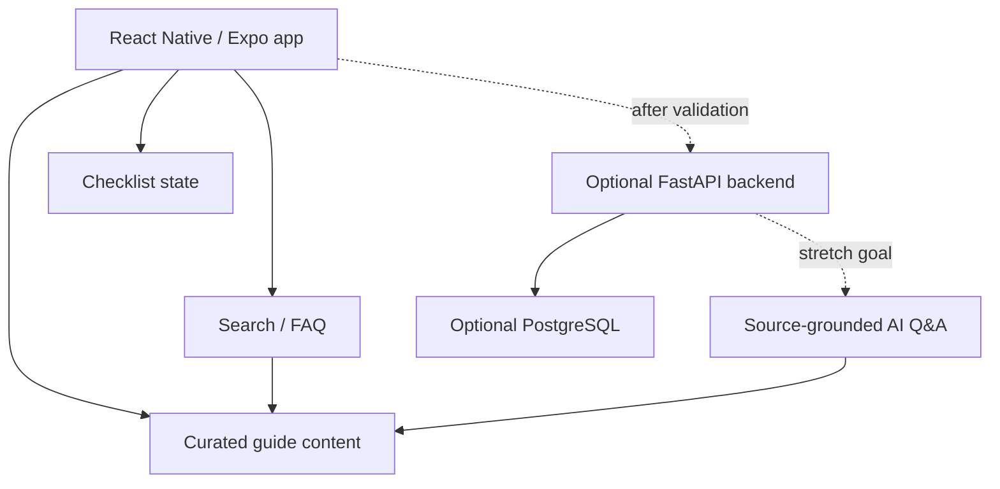

# Proposed technical architecture (unimplemented)

## Initial approach
A mobile-first prototype using **React Native / Expo** with a local static or remote curated content catalog. Avoid backend complexity until the product requires it.

## Proposed content model
- `University`: name, country, supported languages
- `GuideArticle`: title, category, language, body, source URL, last reviewed date
- `ChecklistItem`: title, short instruction, related guide article
- `Feedback`: anonymous issue type and optional text (only with consent)

These are suggested data structures, not implemented database tables.

## Content integrity rules
- Prioritize official university sources.
- Keep the source URL and review date visible.
- Avoid presenting AI-generated answers as official university instructions.
- Fail gracefully when reliable information is unavailable.

## Security and privacy
Do not put API keys in source code or client builds. If an AI provider is added, route access through a secure backend and configure usage limits. Avoid account creation and storing sensitive student records in the MVP.
